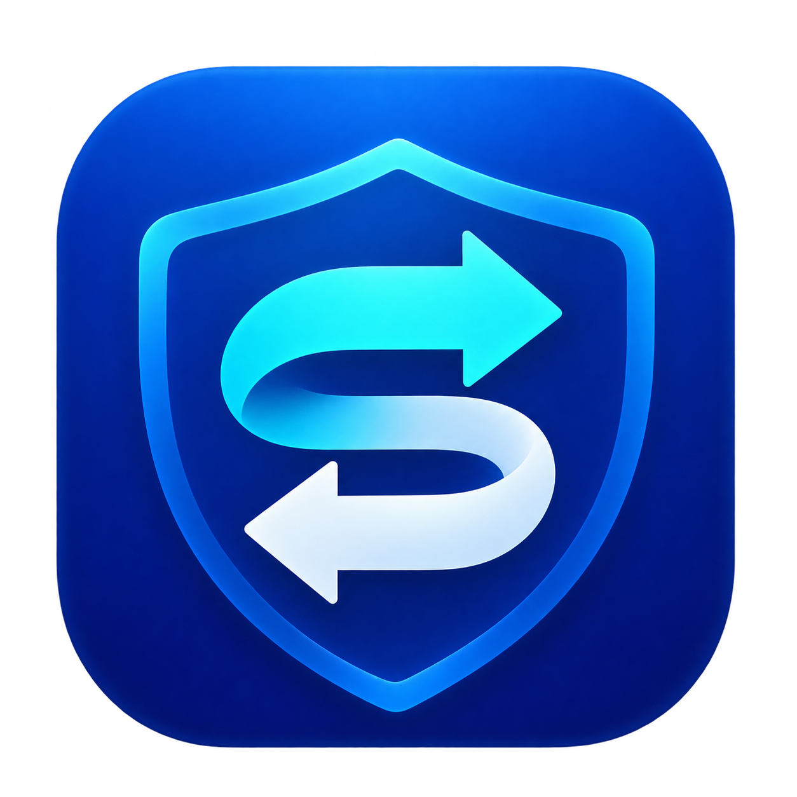

# SFT1 Transfer — Secure File Transfer Protocol & Implementation



本项目为软件与系统安全实验 1B 实现自定义应用层协议 **SFT1**，提供 Python 文件服务器和使用 SwiftUI、AppKit 系统组件的 macOS 原生客户端 **SFT1 Transfer**。

SFT1 在双向 TLS 保护的 TCP 长连接上定义消息边界、请求与响应、文件分块确认、暂停及断点续传。协议采用固定 20 字节报头、JSON 元数据和二进制载荷；TCP 与 TLS 使用现有系统及标准库实现。SFT1 不是 SFTP、SCP 或 FTP，不能直接与这些协议的客户端或服务器互通。

## 项目结构

```text
实验1B/
├── server/ex1b/                  Python 服务端
│   ├── protocol.py              SFT1 报头、消息类型、编解码与输入校验
│   ├── server.py                会话、传输流程、心跳与资源限制
│   ├── storage.py               受限目录访问、临时文件与安全提交
│   ├── database.py              用户、任务及检查点持久化
│   └── cli.py                   服务启动与账户管理入口
├── macos/                       Swift 客户端工程
│   ├── Sources/SafeTransferCore/
│   │   ├── Protocol.swift       SFT1 消息定义与报文编解码
│   │   ├── Connection.swift     TLS 连接、请求响应与心跳
│   │   ├── TransferEngine.swift 传输队列、暂停恢复及多任务调度
│   │   ├── TaskStore.swift      本地任务与检查点持久化
│   │   └── Disk.swift           本地文件访问及完整性处理
│   ├── Sources/SafeTransferApp/ SwiftUI 与 AppKit 原生界面
│   ├── Sources/TransferProbe/   跨语言互传与重启续传验证程序
│   └── Tests/                  Swift 测试
├── tests/                       Python 功能与安全测试
├── fixtures/                    跨语言协议测试样例
├── formal/                      TLA+ 模型、TLC 配置及验证结果
├── deploy/                      容器部署配置
├── compose.yaml                 默认 Docker 服务（SFT1 + SSH）
├── compose.hardened.yaml        强化隔离配置（无 SSH）
├── compose.ssh.yaml             兼容 SSH 启动入口（等同默认配置）
├── scripts/                     证书准备、构建、验证及交付脚本
├── assets/brand/                Logo 原图及设计说明
├── docs/
│   ├── installation.md          安装、启动与首次连接
│   ├── usage.md                 功能使用说明
│   ├── demo-script.md           录屏演示与功能验收脚本
│   ├── protocol.md              SFT1 协议定义与时序图
│   ├── security.md              安全设计与防护边界
│   ├── learning.md              核心代码阅读顺序
│   └── protocol-verification-report.md  协议形式化验证报告
├── pyproject.toml               Python 项目与依赖配置
└── LICENSE                      MIT 许可证
```

运行和构建时还会生成 `runtime/`（证书、账户数据及检查点）、`build/`（macOS 应用）和 `output/`（报告、演示及运行证据）。这些目录不纳入 Git；其中的私钥、密码和用户数据不应公开。

## 文档入口

| 文档 | 内容 |
| --- | --- |
| [安装与启动](docs/installation.md) | 环境准备、服务端启动、客户端编译与启动、首次连接 |
| [演示与验收脚本](docs/demo-script.md) | 分镜操作、解说词、预期结果、剪辑点与测试覆盖 |
| [协议与重点模块讲解脚本](docs/protocol-demo-script.md) | 报头图、各模块时序图、核心实现、CA 签名与形式化验证口播 |
| [协议设计与重点模块 PPT](docs/SFT1_协议设计与重点模块.pptx) | 第 9–13 部分的 10 页录制版，含 SVG 流程图、时序图及讲者备注 |
| [使用说明](docs/usage.md) | 目录浏览、文件与文件夹传输、暂停续传、多任务及用户管理 |
| [SFT1 协议说明](docs/protocol.md) | 报头字段、消息类型、模块时序图、传输状态和恢复规则 |
| [安全设计](docs/security.md) | 身份认证、目录隔离、资源限制与防护边界 |
| [核心代码学习顺序](docs/learning.md) | 协议与实现的阅读路线及需要理解的问题 |
| [协议验证报告](docs/protocol-verification-report.md) | TLA+ 与 TLC 验证过程、检查范围、结果与反例 |
| [模型与复现说明](formal/README.md) | 形式化模型、运行方法和原始日志 |

源码采用 MIT 许可证。
