# SFT1 协议与重点模块讲解脚本

这份脚本接在现有功能演示之后，单独录制。前片的“项目文件架构 / 编译启动”只介绍文件位置；这里结合协议图解释设计和核心代码，不重复编译、上传下载的操作。图中的消息名、字段及函数以当前实现为准。

作者：俞乐楠　学号：202628013229090

## 录制顺序

| 段落 | 大标题 | 画面内容 | 建议时长 |
| --- | --- | --- | --- |
| 9 | SFT1 协议设计 | 分层图、20 字节报头、请求与任务编号 | 60–90 秒 |
| 10 | 各协议模块如何协作 | 初始化与断开、上传、下载时序 | 2–3 分钟 |
| 11 | 重点模块的实现 | 多文件并发、断点续传与持久化确认 | 90–120 秒 |
| 12 | CA 签名与双向认证 | 签发流程图、公开证书字段、验证命令 | 60–90 秒 |
| 13 | TLA+ 与 TLC 形式化验证 | 状态机、不变量、正确结果与故意修改后的反例 | 90–120 秒 |

时长是剪辑建议，不是课程规定。Mermaid 图可在支持 Mermaid 的 Markdown 预览中展示；口播时放大单张图，不把整份文档缩在屏幕上。每个小节均可单独录音和剪辑。

### 配套 PPT：10 页录制版

使用 [SFT1_协议设计与重点模块.pptx](SFT1_协议设计与重点模块.pptx) 录制，沿用提供的 LiteEth PPT 模板。录音时可以直接看每页的演讲者备注。SVG 原图保存在 [assets/protocol-slides](assets/protocol-slides/)。

| 页码 | 章节 | 左侧 | 右侧 |
| --- | --- | --- | --- |
| 1 | 9 | SFT1 / TLS / TCP / IP 分层及 TLS 说明框 | 20 字节报头信息图 |
| 2 | 9 | TCP 接入、客户端证书验证与会话初始化 | 读取报头、校验正文和分派请求 |
| 3 | 10 | TCP 接入、双向 TLS、HELLO / WELCOME | 主动断开、意外断线后的退避重连 |
| 4 | 10 | 上传三方时序图，占整页 | 客户端、服务端、临时文件与任务库 |
| 5 | 10 | 下载三方时序图，占整页 | 客户端、本地临时文件与任务库、服务端 |
| 6 | 11 | 多任务共享一个全双工连接 | 分块请求示例、请求关联与账户带宽 |
| 7 | 11 | 写盘 → 检查点 → ACK | 上传、下载的恢复依据 |
| 8 | 12 | CA 签发时序图，占整页 | CA、服务器身份、客户端身份 |
| 9 | 12 | 双向验证时序图，占整页 | 客户端、服务器、账户数据库 |
| 10 | 13 | 上传确认、文件发布和下载续传的安全性 | 两组有限模型的 TLC 穷举结果 |

下面保留各协议模块的完整时序图，供报告和深入讲解使用；视频按上述 10 页展开。第 10 部分重点讲 10.1、10.6、10.7，即会话、上传和下载。COPY 是额外的服务端内部复制功能，不作为此次传输讲解的主线。LIST、MKDIR、DELETE 可在口播中补充：它们也使用请求、校验执行、返回响应的框架，但没有数据块循环。

## 9｜SFT1 协议设计

### 9.1 分层与设计目标

**画面**：先展示分层图，再展示左右客户端与服务端。图以 TCP/IP 四层模型为主，括号中补充 OSI 对应层。箭头表示上层使用下层的服务，不表示额外建立多条连接。

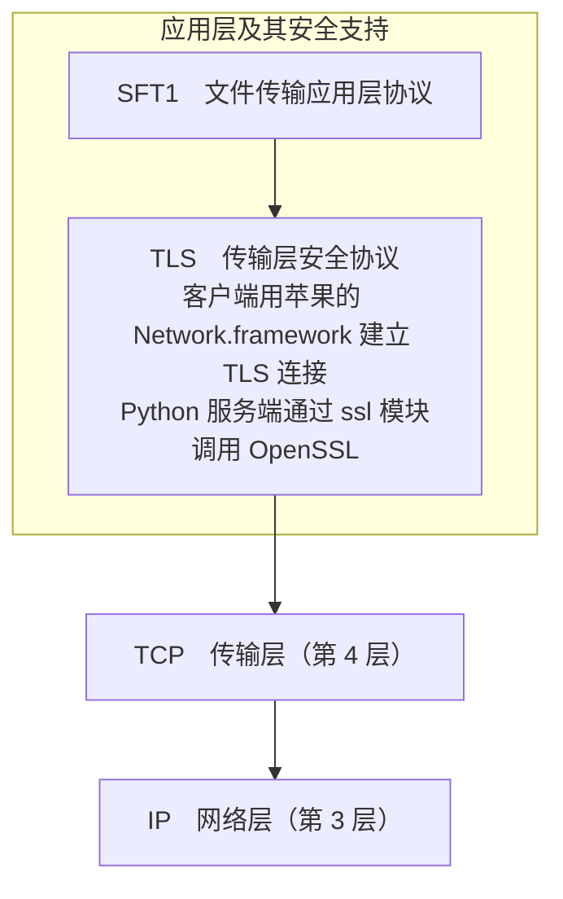

| 协议 | 在本项目中的位置 | 负责什么 |
| --- | --- | --- |
| SFT1 | 应用层；对应 OSI 第 7 层 | 定义文件传输的消息、操作、任务状态和恢复规则 |
| TLS | 位于 SFT1 与 TCP 之间；在 TCP/IP 模型中作为应用层的安全支持 | 为 SFT1 数据提供加密、完整性保护和身份认证 |
| TCP | 传输层；对应 OSI 第 4 层 | 提供可靠、有序的字节流，不解释文件和任务含义 |
| IP | 网际层／网络层；对应 OSI 第 3 层 | 在网络之间寻址、转发数据包 |

> **TLS 是什么？（视频说明框）**
>
> **TLS = Transport Layer Security，中文是“传输层安全协议”。** 在本项目中，它在 TCP 连接上建立安全通道，再承载 SFT1 消息。
>
> - **机密性**：加密传输内容，降低被窃听泄露的风险。
> - **完整性**：检测传输内容是否遭到篡改。
> - **身份认证**：通过证书验证和握手中的私钥持有证明，确认对端身份。本项目使用 **mTLS（双向 TLS）**，客户端验证服务器，服务器也验证客户端。
>
> 建立连接时，TLS 握手协商安全参数和密钥；之后 TLS 记录协议保护实际传输的应用数据。证书用于身份认证，文件内容通过协商出的对称密钥加密。

**分层说明**：TLS 的名称带有“传输层”，但它不等同于 OSI 第 4 层的 TCP。TLS 并非严格按照 OSI 七层模型设计；其功能常与会话层、表示层联系起来，讲解时以实际位置 **SFT1 → TLS → TCP → IP** 为准，不把 TLS 固定说成唯一的某一层。TLS 安全通道及握手、记录协议的说明参见 [RFC 8446 第 1 节](https://www.rfc-editor.org/rfc/rfc8446.html#section-1)。本项目允许 TLS 1.2 及以上版本，连接实际使用的版本取决于双方协商。

**口播**：

> 前面展示了软件的使用，下面解释这些功能背后的协议。这里从上到下是 SFT1、TLS、TCP 和 IP。SFT1 是我们自定义的应用层协议，TCP 属于传输层，IP 属于网络层。TLS 放在 SFT1 和 TCP 之间，为应用数据提供安全保护。
> TLS 的全称是 Transport Layer Security，也就是传输层安全协议。客户端用苹果的 Network.framework 建立 TLS 连接，Python 服务端通过 ssl 模块调用 OpenSSL。本项目使用双向 TLS，所以客户端和服务器都需要验证对方身份。
> 在这个安全通道上，SFT1 进一步规定一条消息如何划分、请求怎样对应响应，以及文件如何分块、确认和恢复。
> 这些层各有职责。例如，TCP 能保证字节顺序，却不知道文件是否已经保存到硬盘。因此，SFT1 还需要自己的持久化确认和完成流程。

### 9.2 报头信息图

**画面**：下图每行 32 位，左侧为字节偏移；报头总长 20 字节。随后依次高亮长度字段、请求编号和正文。

```text
                  0               8              16              24             31  位
                  +---------------+---------------+---------------+---------------+
 字节偏移  0      |                      magic："SFT1"（32 位）                   |
                  +---------------+---------------+---------------+---------------+
 字节偏移  4      | version（8位） |  kind（8位）   |          flags（16位）        |
                  +---------------+---------------+---------------+---------------+
 字节偏移  8      |                      request（32 位）                         |
                  +---------------+---------------+---------------+---------------+
 字节偏移 12      |                  metadata_length（32 位）                     |
                  +---------------+---------------+---------------+---------------+
 字节偏移 16      |                   payload_length（32 位）                     |
                  +---------------+---------------+---------------+---------------+
 字节偏移 20      |          UTF-8 JSON 元数据（metadata_length 字节）              |
                  +---------------------------------------------------------------+
                  |           二进制载荷（payload_length 字节，可为 0）            |
                  +---------------------------------------------------------------+
```

| 字段 | 当前规则 | 解决的问题 |
| --- | --- | --- |
| magic / version | `SFT1` / `1` | 识别协议及版本 |
| kind / flags | 消息类型；flags 当前必须为 0 | 分派操作，拒绝不支持的格式 |
| request | 普通业务请求非零；响应原样带回 | 在同一连接中关联并发请求与响应 |
| metadata_length | 最多 65,536 字节 | 明确 JSON 边界、限制内存占用 |
| payload_length | 最多 65,536 字节 | 明确二进制块边界、限制单块大小 |

多字节整数采用网络字节序，即大端序。JSON 长度计算的是 UTF-8 编码后的字节数，不是汉字个数。Python 格式是 `!4sBBHIII`，Swift 实现相同布局。

**口播**：

> 每条 SFT1 消息由固定二十字节报头、JSON 元数据和可选的二进制数据组成。报头说明消息类型、请求编号，以及后面两部分各有多少字节。接收方先读满报头，检查长度上限，再按长度读取正文，因此不会把一次网络读取误认为一条完整消息。
> 比如心跳请求 PING 的元数据是空对象 `{}`，编码后仍占 2 字节，二进制载荷是 0 字节。加上固定报头，这条消息共 22 字节。一般情况下，报头记录两段正文的字节数 m 和 n，整条消息共 20 + m + n 字节。
> 这里还有两个不同的编号：request 关联一次请求和响应；JSON 中的任务 id 是 UUID，用来在断开重连后找回同一个文件任务。

### 9.3 从字节流解析完整消息

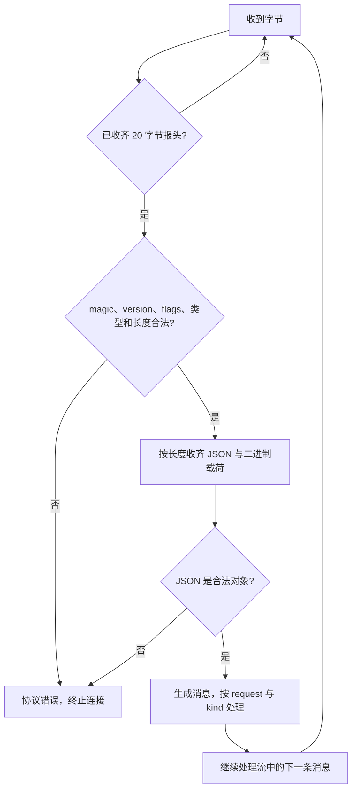

Python 的 `read_frame` 使用 `readexactly`，Swift 的 `PacketDecoder.append` 缓存未收齐的数据并循环取出完整消息。这两种实现都按长度处理消息边界。

## 10｜各协议模块如何协作

以下图按功能模块拆分，覆盖当前 `Kind` 中的所有消息类型。图中的 TLS 握手是概括，不逐条展开 TLS 内部消息；后续 SFT1 消息都在已建立的 TLS 通道内传输。

### 10.1 会话初始化：HELLO / WELCOME

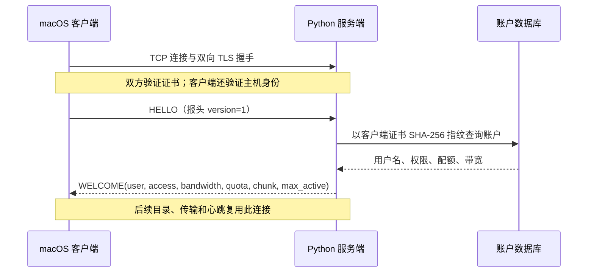

**口播**：

> 双向 TLS 成功后，客户端发送 HELLO。服务端按证书指纹查询账户，再通过 WELCOME 返回身份、读写权限和资源限制。传完一个文件不会关闭连接，后续操作继续复用它。

#### 主动断开与断线重连（PPT 第 3 页）

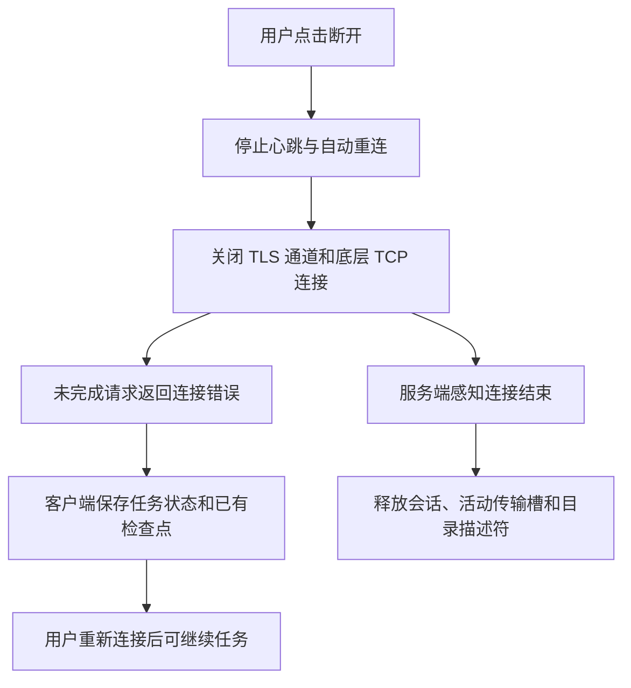

**口播**：

> 点击“断开”，客户端会停止心跳和重连，调用 `NWConnection.cancel()` 关闭当前 TLS/TCP 连接。客户端保留任务和续传位置，服务端检测到断线后释放会话资源。
>
> 如果传到一半断网，客户端检测到掉线后先等 1 秒再试。每失败一次，等待时间翻倍，上限为 30 秒。实际依次等待 1、2、4、8、16、30 秒，后续失败每次都再等 30 秒。成功连上后，客户端重新验证证书并交换 HELLO 和 WELCOME。等待恢复的任务可以点击“继续”。


### 10.2 目录查询：LIST / LIST_RESULT

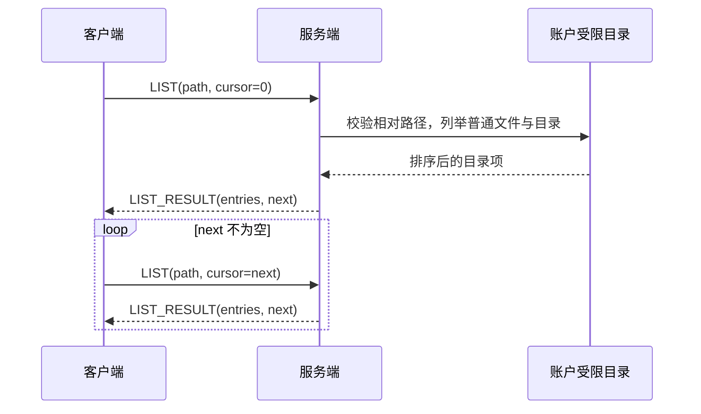

**口播**：

> 目录列表采用分页，一次最多返回一百项。路径始终相对于当前账户的根目录，服务端不会直接使用客户端提交的绝对路径。

### 10.3 新建目录：MKDIR / OK

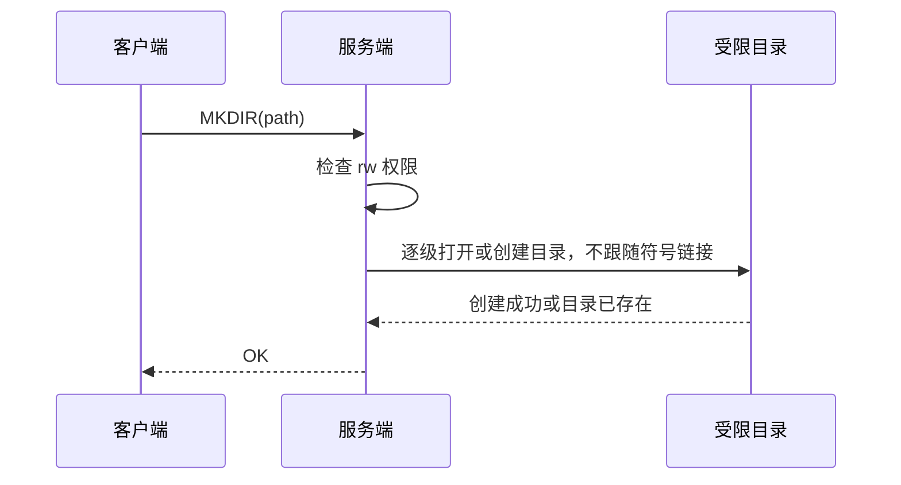

**口播**：

> 新建目录需要读写权限。已有同名目录可以直接确认成功；如果同名对象是文件或不允许的链接，就返回错误。

### 10.4 远端复制：COPY / OK

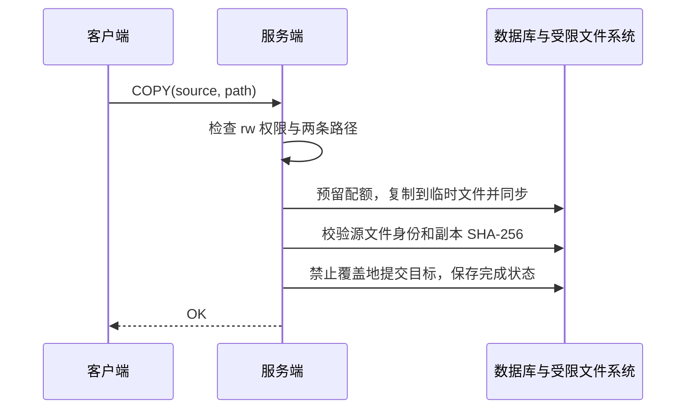

**口播**：

> COPY 处理服务器内部复制一个文件。跨本地和远端的复制粘贴，则由客户端转成上传或下载任务。复制文件夹时，客户端会展开为目录创建和逐文件操作。

### 10.5 删除：DELETE / OK

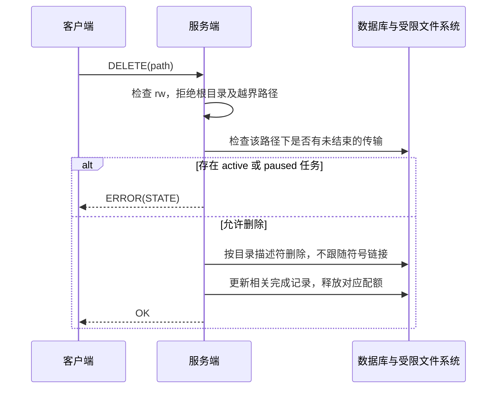

**口播**：

> 删除不仅检查路径和权限，还会检查该路径是否有正在传输或暂停的任务，避免破坏续传数据。本地删除调用系统废纸篓；远端删除通过 DELETE 请求执行。

### 10.6 上传：PUT_INIT / READY / DATA / ACK / FINISH / RESULT

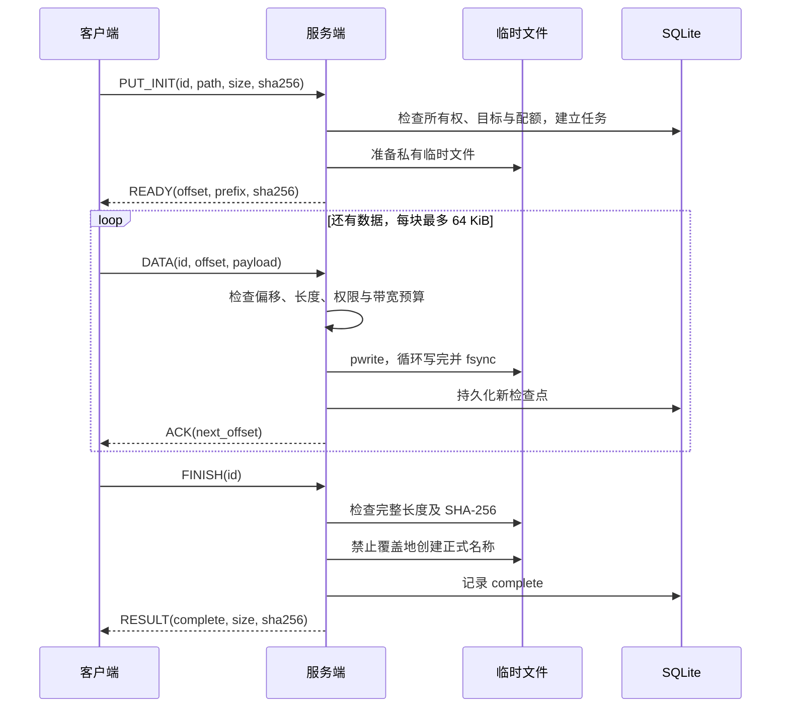

**口播**：

> 上传前先声明文件大小和 SHA-256，接收方把数据写进临时文件。每块数据必须先写完并同步，再保存数据库检查点，最后才能发送 ACK。这样，发送方获得确认的偏移不会超前于接收方已经持久化的位置。
> 全部数据到齐后，还要通过长度和哈希校验，才能发布为正式文件并返回完成。重复的旧块不会再次追加，跳跃、重叠或越界的数据会被拒绝。

### 10.7 下载：GET_INIT / READY / READ / DATA / ACK / FINISH / RESULT

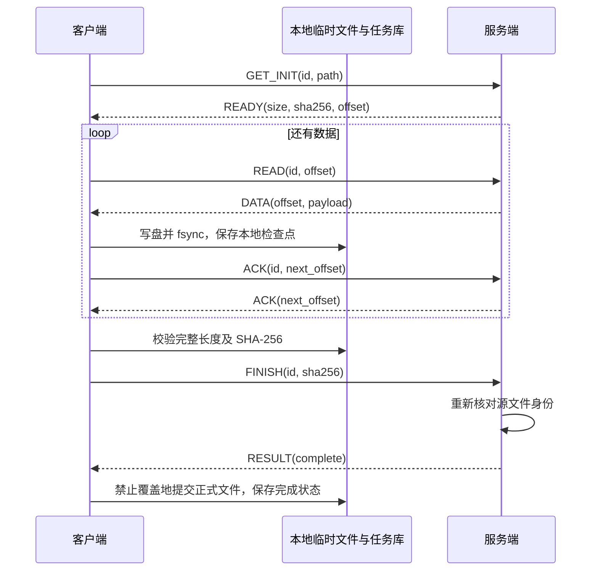

**口播**：

> 下载采用客户端逐块拉取。每块数据在本地写盘并保存检查点后，再向服务器确认。最后客户端校验完整文件，服务器重新核对源文件，双方确认后才提交本地正式文件。因此，网络传完与本地保存成功是分别检查的。

### 10.8 暂停与恢复：PAUSE / RESUME

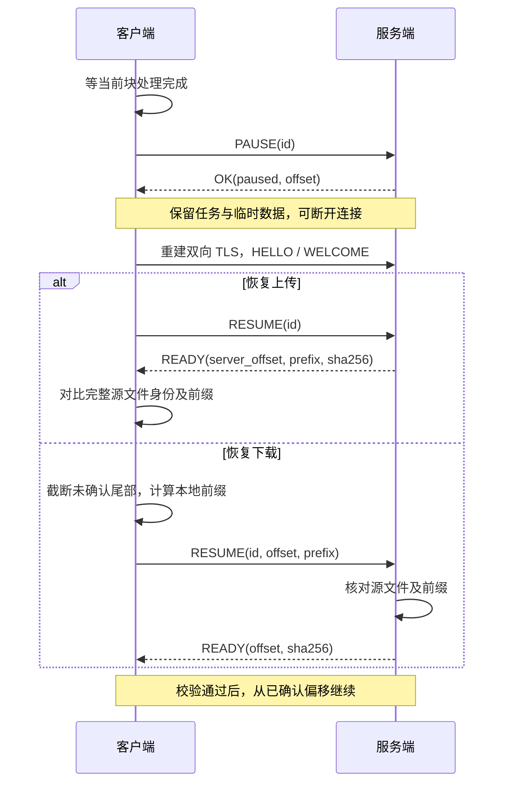

**口播**：

> 恢复上传以服务器的持久化偏移为准，恢复下载以客户端的持久化偏移为准。恢复前还要核对文件身份和已传前缀，避免把不同版本的文件拼接在一起。如果之前已经完成，只是完成响应丢失，服务器可以返回原任务的完成结果。

### 10.9 取消：CANCEL / OK

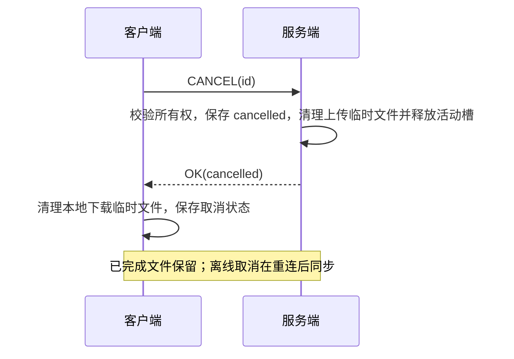

**口播**：

> 暂停保留数据等待继续，取消则结束任务并清理相应临时文件。取消文件夹中的未完成任务，不会回滚已经完成的文件。

### 10.10 心跳与长连接：PING / PONG

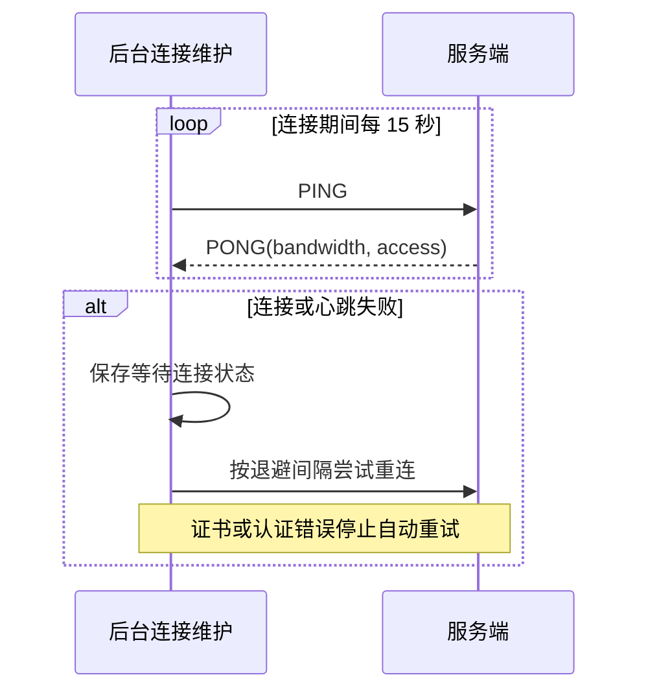

**口播**：

> 长连接由后台维护，既启用 TCP keepalive，也每十五秒发送应用层心跳。PONG 还会携带最新的权限和带宽配置。网络异常会触发退避重连，证书或认证错误则停止自动重试。

### 10.11 错误处理：ERROR

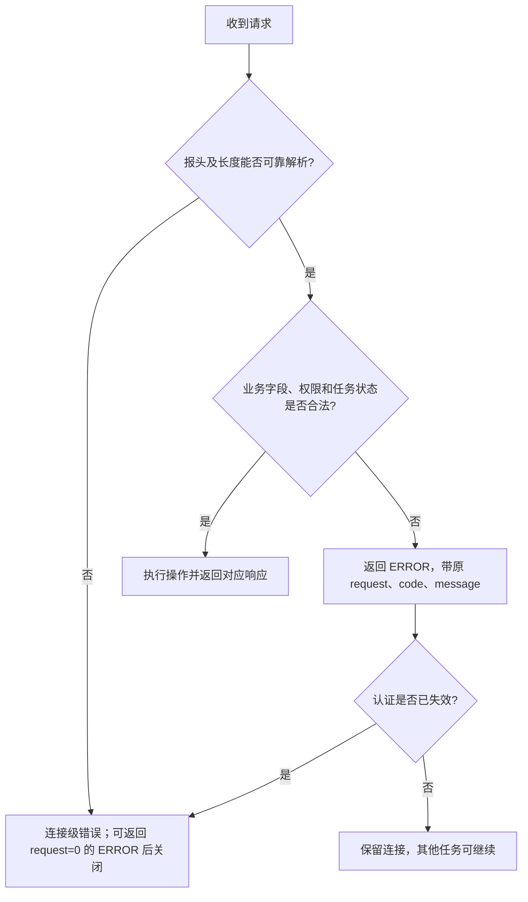

**口播**：

> 错误也有明确的协议格式。普通业务错误携带原请求编号，让客户端定位到对应任务；如果报头失效导致消息边界不可信，就终止连接，避免继续误读后续数据。

## 11｜重点模块的实现

这一段从图切换到源码，每个镜头只展示相关函数。以下链接可用于定位；录制时隐藏与本段无关的文件和窗口。

### 11.1 两端编解码保持一致

**代码画面**：[Python Frame.encode / read_frame](../server/ex1b/protocol.py)、[Swift Packet.encode / PacketDecoder.append](../macos/Sources/SafeTransferCore/Protocol.swift)。

**口播**：

> Python 和 Swift 分别实现同一份报头布局。服务端使用结构体格式打包，客户端按相同字节顺序编码；两端都检查长度上限和 JSON 类型。fixtures 中的协议样例与两端测试，用来检查跨语言格式是否一致。

### 11.2 持久化确认与安全提交

**代码画面**：`server.py` 的 DATA、FINISH 分支 → `storage.py` 的 `write_chunk`、`Jail.commit` → `TransferEngine.swift` 的 `upload`、`download`。

**画面高亮顺序**：写完所有字节 → `fsync` → 数据库偏移 → ACK → 完整哈希 → 正式名称 → complete。

**口播**：

> 这里最关键的是执行顺序。上传先同步文件，再持久化检查点，最后确认；提交时先校验完整内容，再创建正式名称。创建正式名称使用禁止覆盖的文件系统操作，因此不会悄悄替换已有同名文件。下载端也按相同原则处理本地临时文件。

### 11.3 目录隔离与访问权限

**代码画面**：`storage.py` 的 `parts`、`Jail.directory`、`Jail.file`；`server.py` 的 `Session.dispatch` 开头；`database.py` 的参数绑定查询。

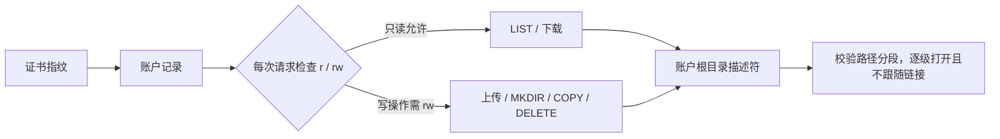

**口播**：

> 证书确定身份，数据库决定这个身份当前能做什么。r 和 rw 没有写死在证书里，服务端会在每次请求时读取账户配置。文件路径先检查分段，再从账户根目录描述符逐级打开，并禁止跟随符号链接。数据库查询使用参数绑定，避免把用户输入拼接进 SQL。

### 11.4 多文件并发与按账户限速

**画面**：上传 A 用 `DATA(id, offset, payload)` 发送文件块，下载 C 用 `READ(id, offset)` 请服务端返回文件块。这里的 `id` 标识传输任务，`offset` 是文件内的字节位置，报头里的 `request` 编号关联请求和响应。同一条 TLS/TCP 连接可以同时传输上传和下载的数据。

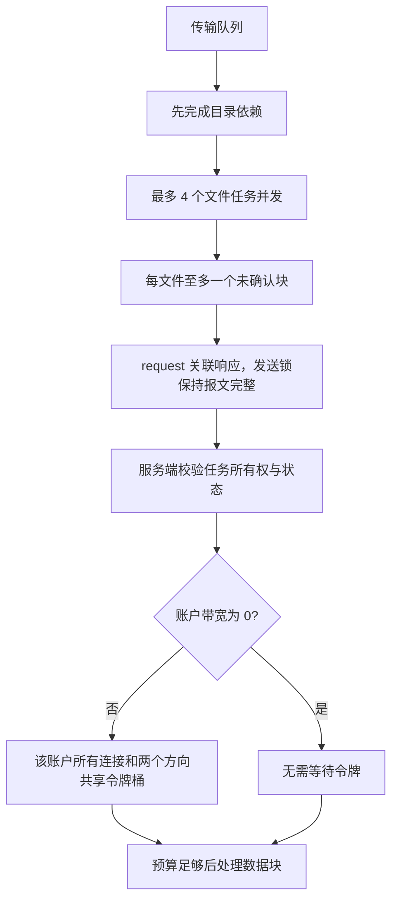

**口播**：

> 客户端先处理目录依赖，再调度最多四个文件任务。在同一连接内，不同任务的消息交错执行，通过请求编号对应响应；发送锁保证一条报文不会被另一条报文插断。
> 带宽预算按账户共享，包含该账户的多个连接以及上传、下载两个方向，不能靠多开任务放大总预算。配置为零表示不限速，二十六万二千一百四十四字节每秒就是二百五十六 KiB 每秒。令牌桶允许短时突发，界面速度又是阶段平均值，因此不要求每一瞬间都恰好显示这个数字。

### 11.5 协议能准确运行的依据

**画面**：用下表逐行回顾，不再重复功能操作。

| 需要保证的事情 | 协议与实现中的依据 |
| --- | --- |
| 两端解析同一条消息 | 固定报头、字节长度、大端序、两端编解码与样例测试 |
| 并发时不会认错任务 | 单次 request 与持久任务 UUID 分开；任务所有权检查 |
| 已确认数据可用于恢复 | 写盘同步、检查点保存先于 ACK；恢复前核对前缀 |
| 不把半个文件当完整文件 | 临时文件、完整长度及 SHA-256 校验、显式 FINISH / RESULT |
| 不覆盖其他文件 | 正式提交禁止覆盖；已有目标返回冲突 |
| 不访问其他账户目录 | 指纹绑定账户、逐请求权限检查、描述符相对访问 |
| 失败后有明确行为 | 错误码、暂停/取消/完成状态、退避重连及恢复规则 |

**口播**：

> 协议正确性的依据可以分成三部分：报文格式让两端准确理解消息；状态和持久化顺序让失败后能够恢复；身份、目录和权限检查限制操作范围。前面的实际演示验证运行效果，下面的模型检查进一步检查选定状态机的规则。

## 12｜CA 签名过程与双向验证

### 12.1 证书如何生成和签发

**代码画面**：[cli.py 的 certificates](../server/ex1b/cli.py)，只展示公开流程及命令结构。

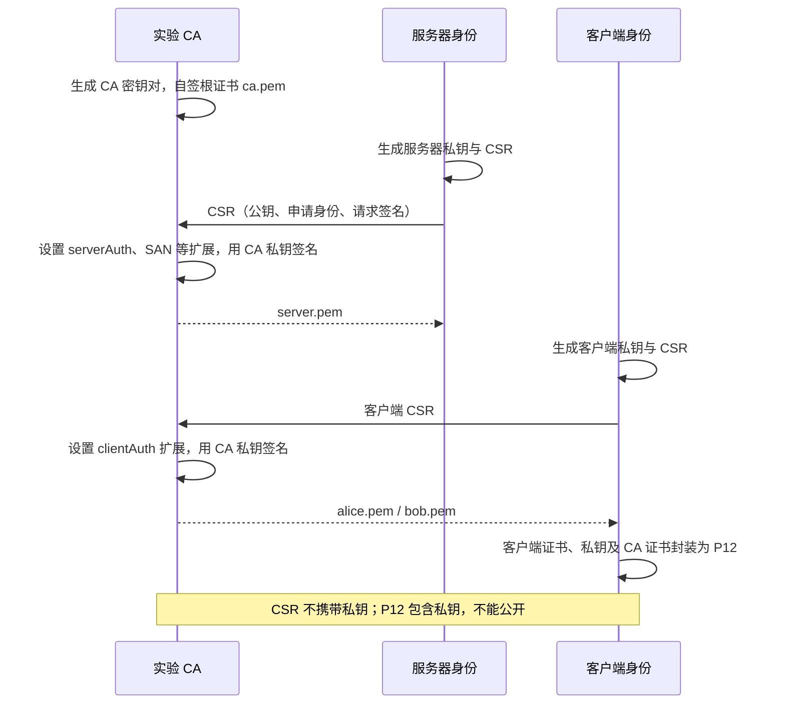

**口播**：

> CA 是证书签发机构，这里使用自己建立的实验 CA。服务器和客户端分别生成密钥对及证书请求，CA 用自己的私钥对证书内容签名，把身份与公钥绑定起来。服务器证书包含服务器认证用途和主机地址，客户端证书包含客户端认证用途。
> 验证方用受信任 CA 的公钥验证证书签名，再检查有效期、用途和目标身份。TLS 握手还会验证对方是否持有对应私钥，只有一份公开证书并不能冒充它。P12 则是客户端身份的封装文件，包含证书和私钥。

当前实现用 OpenSSL 在同一台实验机器上自动完成上述角色，不代表实际存在一个在线 CA 服务。签名提供真实性与完整性，不是把证书内容加密。

### 12.2 可录制的公开证书检查

在项目根目录执行，不重新生成或替换现有证书：

```sh
cd "/Users/vel/Desktop/学习/软件与系统安全/实验1B"
openssl x509 -in runtime/certs/ca.pem -noout -subject -issuer -dates
openssl x509 -in runtime/certs/server.pem -noout -subject -issuer -dates
openssl x509 -in runtime/certs/server.pem -noout -text
openssl x509 -in runtime/certs/alice.pem -noout -text
openssl verify -CAfile runtime/certs/ca.pem -purpose sslserver runtime/certs/server.pem
openssl verify -CAfile runtime/certs/ca.pem -purpose sslclient runtime/certs/alice.pem
```

**画面高亮**：Issuer → Subject → serverAuth / clientAuth → 服务器 SAN 中的 `localhost`、`127.0.0.1` → 两条 `OK`。

上面的 `verify` 展示证书链与用途检查；主机名/IP 的实际校验由客户端连接时执行，不能仅凭这两条 `OK` 声称已验证主机身份。录屏只展示 `.pem` 公开证书，不打开 `.key`、`.password` 或导出 P12 内容。

**口播**：

> 这里可以直观看到签发者、有效期和证书用途。客户端信任实验 CA 来验证服务器，服务器也信任该 CA 来验证客户端，随后再把客户端证书指纹绑定到具体账户。前片中错误 CA 和错误客户端证书的拒绝现象，分别对应这两个方向的检查。

## 13｜TLA+ 与 TLC 形式化验证

**第 10 页口播**

> 传到一半就断线，已经确认的那一块还能找回来吗？我们用 TLA+ 把写盘、保存检查点、发确认和重连写成状态变化，再让 TLC 检查每一种能走到的状态。

> 拿上传举例。一开始，已写入、已记录和已确认的块数都是零。收到一块，先写盘，再把这个位置记进检查点，最后才允许发 ACK。这样，即使刚确认就断线，恢复时读到的检查点也能覆盖刚确认的那一块。我们还检查了另外两件事：文件收全、校验通过才允许发布，下载续传前要核对源文件和本地已经存下来的部分。

> 右边是实际结果。两个上传任务各传两块，每个任务最多崩溃一次，TLC 遍历了 8464 个状态。下载模型用了三块数据，允许崩溃一次，也允许断线后文件内容变化，一共遍历了 70 个状态。两组都没有发现违反相应性质的状态。作为对照，把发 ACK 提前到保存检查点之前，TLC 就找到了“已确认一块，检查点仍为零”的反例。

### 13.1 模型检查什么

**画面**：[SFT1Upload.tla](../formal/SFT1Upload.tla)、[SFT1Download.tla](../formal/SFT1Download.tla) 与下图。先讲变量和动作，再展示性质，避免直接铺满公式。

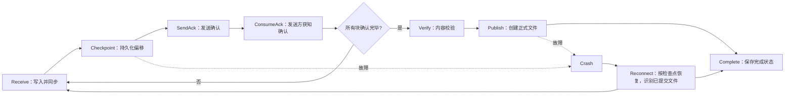

图中虚线只画两个故障示例位置，模型允许故障插入多个持久化阶段边界。恢复分支有条件：已发布文件按模型恢复为完成；否则回到持久化检查点继续。

**口播**：

> TLA+ 是描述系统状态及变化规则的规范语言，TLC 是枚举有限可达状态的模型检查器。这里把文件抽象成几个数据块，把上传拆成写盘、检查点、确认、校验和提交等动作，再允许故障插入这些步骤之间。
> 与只运行一次正常传输相比，模型检查可以系统地探索不同动作顺序，并检查每一个可达状态是否违反约束。

### 13.2 展示三个关键性质

| 性质 | 屏幕上展示的表达式 | 口播解释 |
| --- | --- | --- |
| 确认不超前 | `ack <= cp <= disk <= Blocks` | 已确认偏移不能超过持久化检查点，检查点不能超过已落盘长度 |
| 正式文件完整 | `published => disk = cp = Blocks /\ good` | 文件完整且内容正确时才能发布 |
| 恢复身份正确 | `online => sourceOK /\ prefixOK` | 下载恢复必须通过源文件与前缀检查 |

**口播**：

> 第一条检查确认顺序，第二条检查正式文件的完整性，第三条检查恢复时的文件身份。模型还检查终态保持和恢复所有权。最终完成属于另一类活性性质，需要额外假设故障有界、系统最终继续调度，并且用户不一直暂停或取消。

### 13.3 正确模型与故意修改规则的对照

**录制命令**：

```sh
python3 scripts/verify_protocol.py
```

该命令运行 18 个配置，更新 `formal/results/`；首次运行需要 Java 和下载 TLC 工具。也可以展示现有结果摘要与原始日志，明确称为“已有结果”，不用把查看日志剪成正在执行检查。

```sh
python3 - <<'PY'
import json
from pathlib import Path
report = json.loads(Path('formal/results/summary.json').read_text())
for row in report['results']:
    print(f"{row['case']:<34} states={row['distinct']:<5} "
          f"exit={row['exit_code']:<2} expected={row['expectation_met']}")
PY
```

| 镜头 | 配置或日志 | 已有结果 | 讲解重点 |
| --- | --- | --- | --- |
| 正确规则 | `upload_concurrent` | 8,464 个不同状态，无错误 | 两个任务的数据块交错及故障恢复 |
| 故意提前确认 | `upload_mutant_early_ack` | 8 个不同状态时发现 `AckDurable` 反例 | `disk=1, cp=0, ack=1`，确认先于检查点 |
| 故意跳过恢复身份 | `download_mutant_resume` | 14 个不同状态时发现 `ResumeIdentity` 反例 | 文件或前缀不匹配却恢复连接 |

**口播**：

> 已有结果中，六个正确配置都完成检查，没有发现所检查性质的错误。其中双任务上传遍历了八千四百六十四个不同状态。为了检验模型能否发现错误，我还故意提前发送确认、跳过恢复身份检查，TLC 都给出了违反约束的执行路径。
> 这十四个配置中包含预期失败的对照实验，所以部分非零退出码正是预期结果。这些反例来自故意修改后的模型，不能说实际软件存在同样的问题。

### 13.4 准确说明验证范围

**画面字幕**：有限状态模型检查；上传、下载和恢复；结合源码与运行测试。

**口播**：

> 这个结论有明确范围：模型验证的是有限块数、有限故障条件下的上传、下载及恢复规则。TLS 和哈希被当作可信基础，目录管理、带宽调度等没有纳入这次模型，模型到源码也没有做完整的形式化精化证明。因此，这是一项支持协议设计的验证证据，需要结合源码检查和实际测试，不能表述为整个软件绝对正确。

结果细节见 [协议验证报告](protocol-verification-report.md) 和 [formal/README](../formal/README.md)。源代码后续已经加入文件管理、权限及不限速等改动；讲解时将上述模型结果限定在所列上传、下载状态机，不把旧结果扩展为这些新增模块的形式化验证。

## 剪辑与完成检查

- 保留现有功能演示，新增段落接在其后，编号从 9 开始。
- 协议图先完整展示，再沿箭头高亮；报头、时序图、源码使用相同字段名。
- 每个图都有对应口播；COPY、DELETE、取消、心跳和错误处理也包含在协议模块中。
- 重点代码按“规则 → 对应函数 → 为什么这样做”讲解，不逐行读源码。
- CA 展示签发与双向验证的区别；r/rw 属于账户授权配置。
- TLC 同时展示正常结果和故意修改后的反例，保留模型范围说明。
