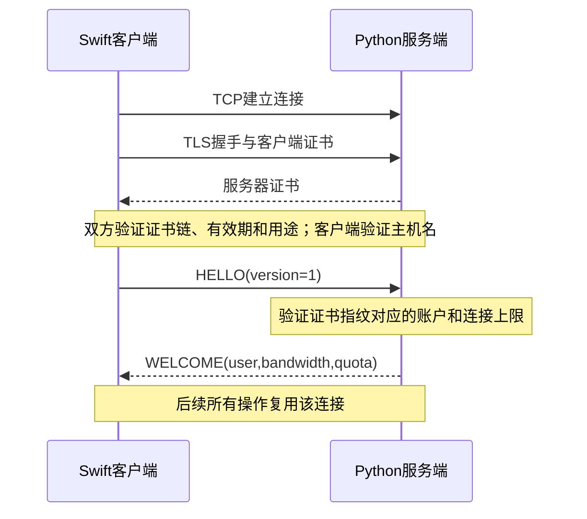
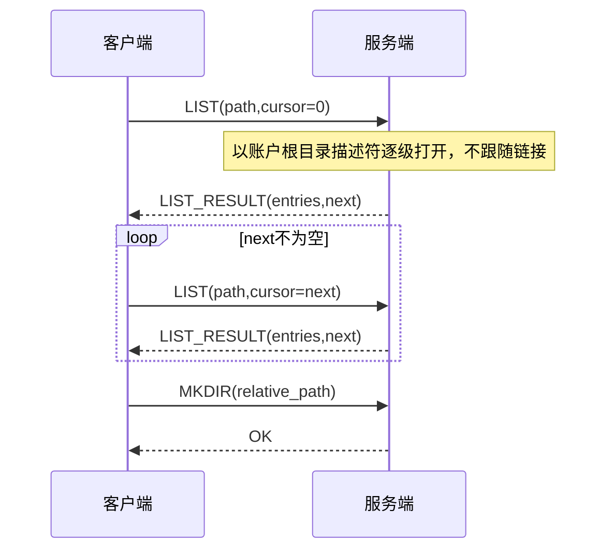
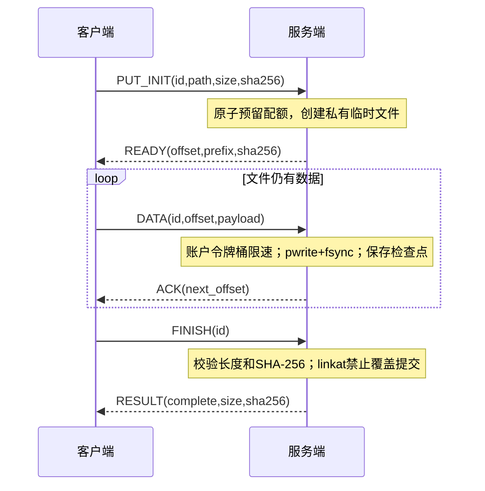
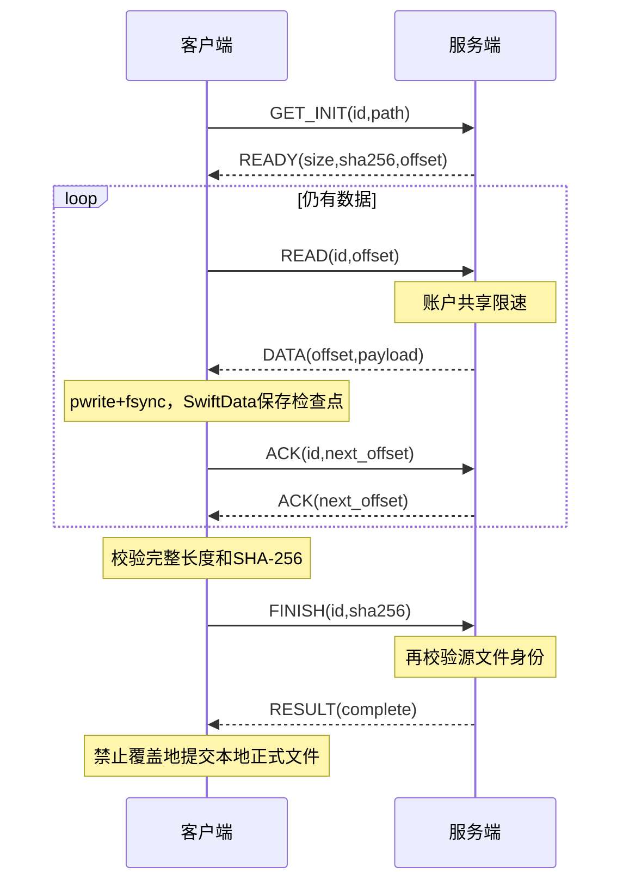
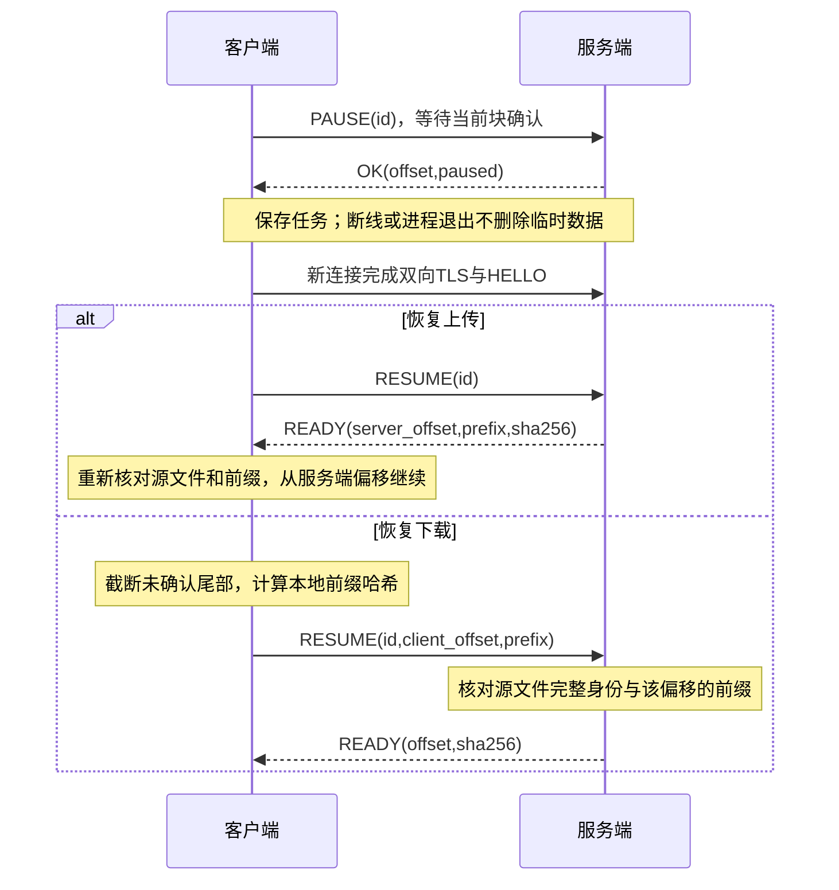
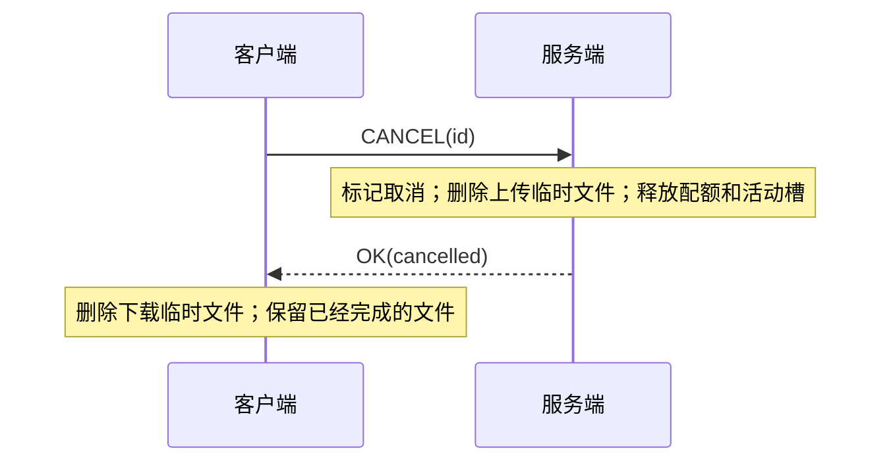
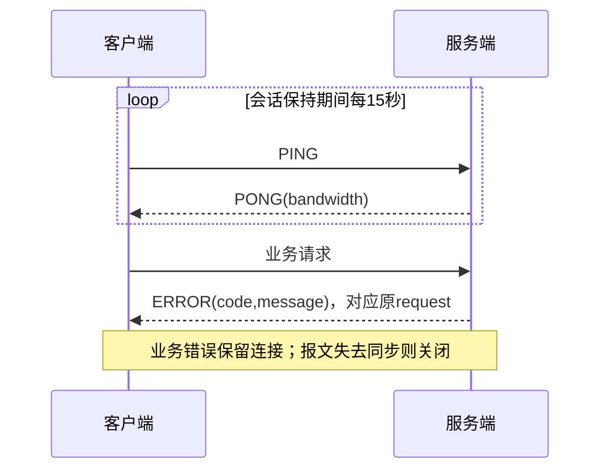
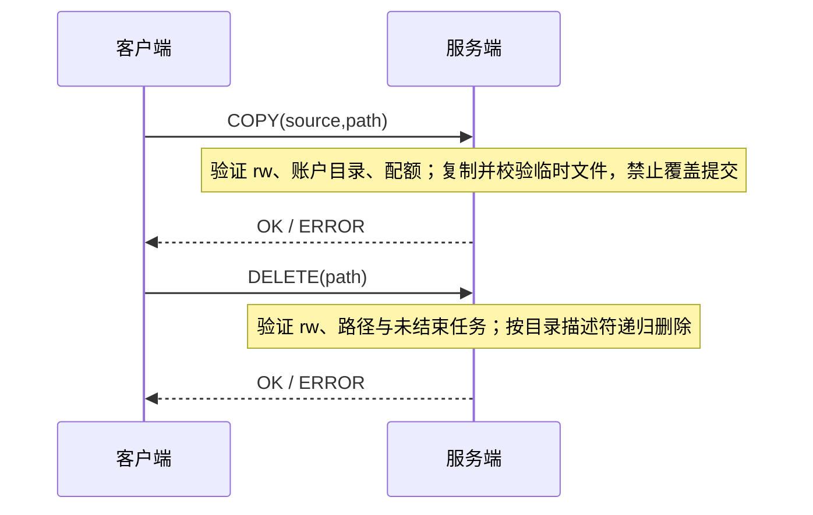

# SFT1 应用层协议

SFT1 是本项目设计并实现的应用层协议，由 Python 服务端和 Swift 客户端共同遵循；它不是 SFTP、SCP 或 FTP，也不兼容这些协议的现成客户端。TCP 和 TLS 使用系统及标准库提供的实现。

SFT1运行于双向TLS的TCP字节流之上。TLS负责加密及对端身份验证，SFT1负责划分消息、关联请求、安排文件数据和持久化传输状态。文件结束不依靠关闭连接判断。

## 报头与字段

固定20字节，网络字节序，对应Python `!4sBBHIII`：

| 字节偏移 | 字段 | 长度 | 含义 |
|---|---|---|---|
| 0 | magic | 4 | ASCII SFT1 |
| 4 | version | 1 | 当前为1 |
| 5 | kind | 1 | 消息类别 |
| 6 | flags | 2 | 当前必须为0 |
| 8 | request | 4 | 非零会话内请求编号；响应原样回传 |
| 12 | metadata_length | 4 | UTF-8 JSON字节数，最多65536 |
| 16 | payload_length | 4 | 文件数据字节数，最多65536 |

报文正文为JSON对象，再接二进制载荷。所有长度指字节，不是字符数。文件大小及偏移位于JSON整数中。单文件上限1GiB。接收端先验证报头，再读指定长度，禁止按一次TCP读取划分报文。

| 类型值 | 消息 | 主要元数据 |
|---|---|---|
| 1 / 2 | HELLO / WELCOME | version；user、bandwidth、quota、chunk、max_active |
| 10 / 11 | LIST / LIST_RESULT | path、cursor；entries、next |
| 12 / 13 | MKDIR / OK | path；状态确认 |
| 14 / 15 | DELETE / COPY | path；source、path，成功返回 OK |
| 20 / 21 / 22 | PUT_INIT / GET_INIT / READY | id、path；size、sha256、offset、direction、status、上传prefix |
| 23 / 24 / 27 | DATA / ACK / READ | id、offset；DATA带二进制块，ACK给出下一偏移 |
| 25 / 26 | FINISH / RESULT | id；status、size、sha256 |
| 30 / 31 / 32 | PAUSE / RESUME / CANCEL | id；下载恢复另带offset及prefix |
| 40 / 41 | PING / PONG | PONG可更新账户带宽信息 |
| 255 | ERROR | code、message |

`id`是规范的小写UUID，不含路径，跨连接及重启保持不变。`request`只关联当次请求和响应。业务错误只影响当前任务；无效报头等失去同步的问题关闭连接。连接级ERROR使用request=0。

## 身份初始化

## 目录查询与创建

每页最多100个条目；目录超过10000条拒绝列举。根路径使用空字符串，其他路径不能包含空段、点段、绝对路径或反斜杠。MKDIR对已有目录幂等，遇到文件或链接失败。

## 上传

每个文件同一时刻只有一个未确认数据块，不同文件的请求交替执行。完全重复且已确认的数据块只返回当前偏移，不重复追加。跳跃、重叠及越界数据被拒绝。ACK在文件同步及数据库检查点落盘后发送。声明的完整哈希不匹配时不产生正式文件。

## 下载

下载采用客户端按块拉取，便于暂停、持久化确认及与其他传输公平交替。私有临时文件与目标位于同一文件系统。服务端RESULT与客户端落盘结果分别检查，不把网络完成直接视为本地保存成功。

## 暂停与恢复

上传以服务端检查点为准，下载以客户端检查点为准。恢复前核对任务所有权。前缀、完整源文件身份或临时文件长度不符时停止恢复。已完成任务返回RESULT，支持完成响应丢失后的查询。提交创建正式链接后崩溃时，通过文件身份和相同inode的链接恢复，不覆盖其他文件。

## 取消

离线取消先保存为“取消待同步”，重连后同步服务端。整组目录任务逐项取消，不回滚已完成文件及已建目录。

## 心跳和错误

TCP keepalive与应用心跳同时开启。服务器45秒没有完整消息则关闭连接；半包15秒超时。客户端心跳请求10秒超时，触发重连；重连等待依次为1、2、4、8、16、30秒。证书和认证错误停止重试。用户手动退出后关闭连接。

## 任务状态

客户端：排队 → 校验 → 传输 → 完成，可转入暂停、等待连接、失败或取消。重启时未完成任务转为暂停，由用户手动继续。服务端保存active、paused、complete、cancelled、failed状态。源文件变化后需要取消旧任务并重新添加。

文件夹是客户端持久化的目录及文件任务集合，不引入另一种数据通道。目录任务先执行，文件任务最多4个并发；失败文件不会阻止其他文件。已完成内容保留，重启后只恢复未完成部分。

## 形式化验证

选定的上传及下载状态机已建立 TLA+ 模型，配置、复现步骤和原始 TLC 输出见 [formal](../formal/README.md)。单独的[协议验证报告](protocol-verification-report.md)说明安全性、带假设的活性、故意修改规则后的反例，以及模型范围和限制。该结果不构成整个实现或 TLS 的完整正确性证明。

## 文件管理扩展与权限

WELCOME、PONG 返回 `access=r|rw`。证书指纹关联账户权限；服务端每次请求重新读取账户。只读拒绝 MKDIR、DELETE、COPY、PUT_INIT、DATA 及上传任务的 RESUME、FINISH；允许取消上传以清理数据。

COPY 复制单个文件；目录复制由客户端通过 LIST、MKDIR、COPY 展开，最多 10000 条目、32 层，部分成功不回滚。DELETE 拒绝根目录和越界路径，递归删除不跟随符号链接；有 active/paused 任务的目标路径拒绝删除。删除成功后释放相应已完成上传的配额。批量操作逐项确认，超限或错误可能留下部分已完成结果。上传及下载的现有 TLA+ 模型未覆盖这些新增文件管理消息与权限配置。

`WELCOME` 和 `PONG` 中 `bandwidth=0` 明确表示账户不限速，客户端显示“不限速”；正值表示每秒字节上限。
